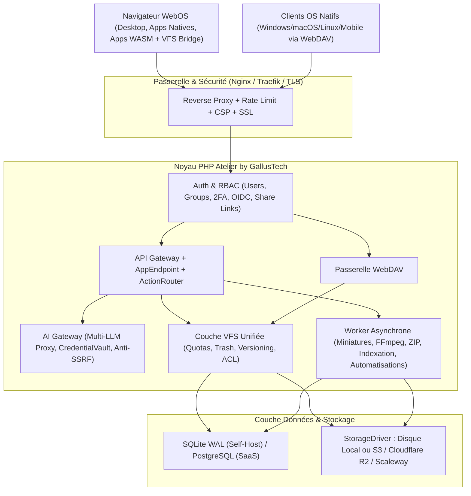

# 🗺️ Atelier by GallusTech — Feuille de Route Technique (`ROADMAP.md`)

Ce document recense exclusivement les **chantiers techniques et produit restant à réaliser** pour **Atelier by GallusTech**.

> 📌 **Documents complémentaires** :
> - [`BUSINESS.md`](BUSINESS.md) : vision produit, positionnement marketing, modèles économiques (Open-Core / SaaS / B2B), Go-To-Market et risques.
> - [`TODO.md`](TODO.md) : backlog opérationnel court terme (outils, jeux, améliorations ponctuelles).

---

## 1. Socle Déjà Livré *(Résumé)*

Les fondations cloud, sécurité, IA et Explorateur sont en production et validées par **1 015 / 1 015 tests automatisés** (`php tests/run_tests.php`) :

| Phase | Périmètre livré | Statut |
|---|---|:---:|
| **Phase A** | Multi-utilisateurs SQLite WAL / JSON, RBAC 3 niveaux, inscription autonome, SMTP natif, 2FA TOTP + QR SVG local, OIDC PKCE, liens `/s/<token>`, quotas, sessions actives, export/suppression RGPD (`/e/<token>`). | ✅ |
| **Phase B** | `StorageDriver` (Local, S3/R2 SigV4, WebDAV, Google Drive) en `ext://`, `CredentialVault` AES-256-GCM, uploads chunked résumables, Corbeille 30j, versioning léger (5 révisions), index SQLite incrémental. | ✅ |
| **Phase C** | Passerelle WebDAV `/dav/` (App Passwords), worker asynchrone (`bin/worker.php`), sauvegardes d'instance ZIP + SHA-256, Docker Compose (PHP-FPM/Nginx/Supervisor/FFmpeg), assistant `/setup`, PWA. | ✅ |
| **Phase D (Lots 1–2)** | Pont natif `?host=parent` + Synthétiseur v2 (`apps/external/`), déploiement admin ZIP/URL anti-SSRF, veille SemVer GitHub avec validation admin, associations par défaut par utilisateur. | ✅ |
| **Phase E (Lots 1–4)** | Agent IA Universel **Compagnon** (`Ctrl+K`, multi-LLM OpenAI/Anthropic/Gemini/Ollama, Human-in-the-Loop, `WebAppAgentBridge` `craft-web-api` + `webos:agent-*`, contrat `WebOSApp`). | ✅ |
| **Phase G (Lots 1–6)** | Refonte complète de l'**Explorateur** : architecture modulaire, 3 profils (Pro Liste unifiée dossiers en premier / Vignettes / Multimédia) avec héritage par dossier, onglets, sidebar arborescente, Double Volet `F3`, zéro clic droit navigateur, transferts chunked/dossiers, Inspecteur 3 onglets (EXIF/Tags/Versions), Corbeille inline, Quick Look `Espace`, recherche multi-critères SQLite, flèches 2D, 9 outils IA et page dédiée dans les Paramètres (Simple/Double clic). | ✅ |

---

## 2. Architecture Cible Cloud (Vue d'Ensemble)

> **Invariant préservé** : en mode auto-hébergé (*Community / Single-Node*), **SQLite (`PDO_SQLITE`) + disque local** restent le défaut zéro-dépendance déployable en 60 secondes.

---

## 3. Chantiers Restants

### ⚡ Phase H — Productivité Avancée, Automatisations & Time Machine (« Git-like »)
*Objectif : transformer Atelier en un poste de travail ultra-productif en exploitant les briques déjà présentes (`bin/worker.php`, `LlmGateway`, `TrashAndVersioningManager`, `AgentToolRegistry`, `AtelierStore`), tout en restant 100 % fidèle à la stack légère PHP + SQLite + JS Vanilla.*
*(Hors périmètre assumé : la co-édition temps réel CRDT multi-curseurs, trop dépendante du cœur interne de chaque application tierce WASM et inadaptée au modèle PHP stateless, est remplacée par un verrouillage doux léger).*

- [ ] **Lot 1 — Hub IA Multi-Fenêtres & Contexte Attaché** *(effort `S`)* :
  - Enrichir `os_list_open_windows` pour exposer le `getAgentContext()` de **toutes** les fenêtres ouvertes et permettre à `Compagnon` de cibler une fenêtre spécifique par `window_id` (ex. transférer/croiser des données entre *GridCraft* et *DeckCraft* / *WordCraft*).
  - **Contexte attaché dans le chat Compagnon** : glisser-déposer un fichier depuis l'Explorateur dans la popup Compagnon ou mentionner `@fichier` / `@fenêtre`.
- [ ] **Lot 2 — Automatisations (« Workflow Studio » / IFTTT intégré)** *(effort `M`)* :
  - Tables SQLite `automation_rules` et `automation_runs` dans `AtelierStore`, exécutées de manière asynchrone par `bin/worker.php`.
  - **Déclencheurs** : `on_upload` (dossier + glob/extension), `on_dropbox_upload` (boîte de dépôt `/s/<token>`), `on_tag_added`, `schedule` (cron simple dans le worker).
  - **Actions natives** : auto-tagging (`ShareManager::setItemTags`), déplacement/renommage VFS, résumé / extraction / classification IA vers Markdown (`LlmGateway` via clé utilisateur AES-256-GCM), notification email (`MailService`) et webhook sortant (filtré par `UrlValidator` anti-SSRF).
  - **Garde-fous stricts** : prévention des boucles infinies (`depth <= 1`), exécution dans les strictes ACL du propriétaire de la règle, journal d'exécution et plafond de quota/coût sur les actions IA.
- [ ] **Lot 3 — Time Machine & Historique « Git-like » Visuel** *(effort `M`)* :
  - Faire évoluer `TrashAndVersioningManager` vers un stockage **dédupliqué par empreinte `SHA-256`** (*content-addressed store* en pur PHP, sans dépendre du binaire `git`), permettant de monter la rétention (20–50 révisions) à coût disque minimal.
  - **Jalons nommés (« Snapshots / Tags »)** au niveau fichier **ou dossier entier** (manifeste JSON pointant vers les hashes SHA-256 des fichiers à l'instant T, avec note de révision).
  - **Diff visuel intégré dans l'Explorateur** : diff texte/code ligne-à-ligne en JS pur (`.md`, `.txt`, `.json`, code) et **comparateur Avant/Après à curseur** pour les images.
- [ ] **Lot 4 — Productivité Quotidienne & Présence Légère** *(effort `S`)* :
  - **Palette de commandes globale (`Ctrl+Shift+P`)** façon Spotlight / Raycast : recherche instantanée SQLite, lancement d'applications, bascule de thèmes/vues et actions système au clavier.
  - **Modèles de documents (`.templates/`)** dans le menu `+ Nouveau` de l'Explorateur (compte-rendu de réunion, suivi de projet, budget, note structurée).
  - **Verrouillage doux collaboratif (*Soft-Lock* & Présence légère)** : avertissement non-bloquant si un autre utilisateur édite déjà le même fichier VFS (*« Ouvrir en lecture seule ou dupliquer ? »*).
  - **Widget Mode Focus / Pomodoro & Ambiance sonore** *(optionnel, effort `XS`)* : minuteur Pomodoro en barre des tâches + paysages sonores générés localement en **Web Audio API pure** (pluie, vent, bruit rose — zéro fichier audio tiers, zéro problème de licence).

---

### 🟧 Phase D *(Fin)* — Galeries de Livraison Client & Marque Blanche
*Objectif : livrer les deux fonctionnalités commerciales à forte valeur perçue pour photographes, créatifs et studios B2B.*

- [ ] **Mode « Galerie de Livraison Client »** *(effort `M`)* :
  - Présentation épurée sans barre WebOS complexe sur les liens partagés `/s/<token>` : choix de mise en page (Mosaïque / Polaroid / Cinéma).
  - **Filigrane dynamique** sur les aperçus (protégeant les originaux HD avant validation/paiement).
  - Système de **sélection / favoris client** (*proofing*), commentaires horodatés et téléchargement sélectif ZIP HD.
- [ ] **Marque Blanche (*White-Label*) complète** *(effort `S–M`)* :
  - Personnalisation par instance/organisation : nom de marque, logo, favicon, domaine personnalisé (`cloud.monstudio.fr`), palette de couleurs, page de connexion et mentions légales.

---

### ☁️ Phase B *(Extensions optionnelles)* — Connecteurs Cloud & Imports Tiers
- [ ] Connecteurs additionnels dans `ExternalMountManager` : **OneDrive** / **Dropbox**.
- [ ] Assistant OAuth interactif **Google Picker** (`drive.file` / Google Photos Picker API).
- [ ] Connecteur **Instagram Business/Creator Graph API** & importateur d'archives **Meta / Google Takeout**.

---

### 🟥 Phase F — Infrastructure SaaS Hébergée (« Atelier Cloud »)
*Objectif : proposer un service hébergé clé en main, rentable dès les premiers clients et sécurisé par isolation stricte (voir [`BUSINESS.md`](BUSINESS.md) pour la tarification et le Go-To-Market).*

- [ ] **Architecture « Silo par Client »** :
  - Chaque client/studio dispose de **son propre micro-conteneur isolé + sa base SQLite dédiée + son préfixe/bucket S3/R2 dédié** (Docker / Coolify / Nomad + Traefik TLS automatique) pour une isolation maximale et une migration/résiliation triviale.
- [ ] **Portail Client & Facturation (Control Plane)** :
  - Inscription, choix de formule, paiement récurrent (Stripe / Paddle), provisionnement automatique en < 30 secondes, gestion du domaine personnalisé et suivi de consommation de stockage.
- [ ] **Souveraineté & Coffre-fort E2EE (Option future)** :
  - Hébergement 100 % européen (Hetzner / Scaleway / OVH + Object Storage EU), TLS 1.3 + chiffrement au repos, et option **coffre-fort chiffré de bout en bout (E2EE / Zero-Knowledge côté client)** via WebCrypto API (schéma DB déjà prêt en Phase A.1).

---

## 4. Ordre de Priorité Recommandé

1. **Phase H (Lots 1 → 4)** : Productivité avancée — Hub IA multi-fenêtres, **Workflow Studio**, **Time Machine « Git-like »**, Palette `Ctrl+Shift+P`, modèles `.templates/` et *Soft-Lock* *(effort `M` — fort impact quotidien)*.
2. **Phase D (fin)** : Galeries de Livraison Client (proofing, filigrane, sélection) + Marque Blanche *(effort `M` — différenciateur commercial immédiat)*.
3. **Phase F** : Démo live publique + Control Plane SaaS (« Atelier Cloud ») *(effort `L` — monétisation récurrente en silos isolés)*.
4. **Phase B (extensions)** : Connecteurs cloud additionnels (OneDrive/Dropbox/Google Picker/Takeout) selon la demande terrain.
