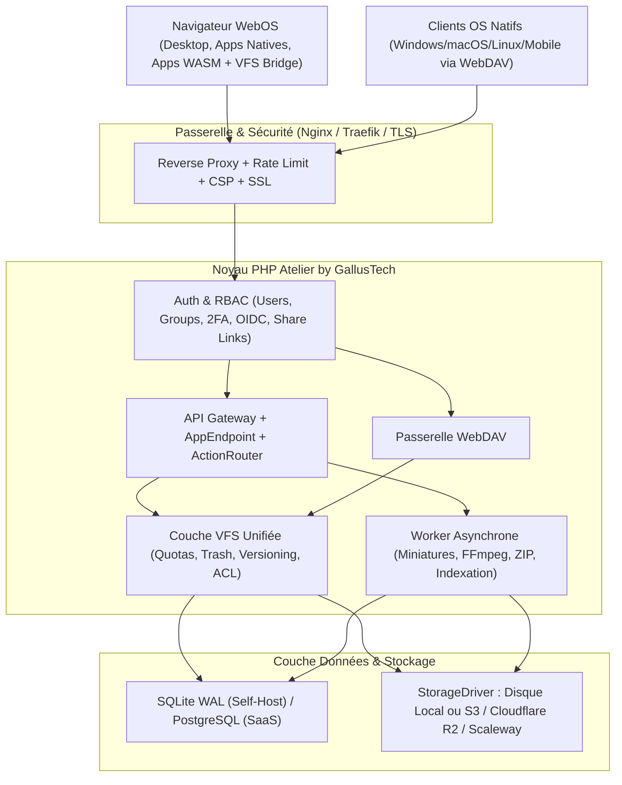

# 🗺️ Atelier by GallusTech — Feuille de Route Produit, Technique & Business (`ROADMAP.md`)

Ce document présente la **vision stratégique**, l'**écart technique** vis-à-vis des plateformes cloud établies (*Nextcloud / ownCloud, Google Drive, Dropbox, Synology DSM, Pixieset*) et le **plan de transformation progressif** permettant de faire évoluer **Atelier by GallusTech** d'une galerie/WebOS mono-admin auto-hébergée vers un **produit Cloud & Bureau Web souverain commercialisable**.

> 📌 **Articulation avec [`TODO.md`](TODO.md)** :
> - `TODO.md` suit le **backlog opérationnel court terme** (fonctionnalités applicatives WebOS, jeux, outils, qualité).
> - `ROADMAP.md` définit la **trajectoire produit, architecture cloud, hébergement et monétisation** à moyen/long terme.

---

## 1. Vision Produit & Avantage Compétitif (« Unfair Advantage »)

### ❌ Le piège à éviter
Affronter frontalement **Google Drive / Dropbox** (stockage quasi gratuit + suite collaborative temps réel + effet réseau) ou **Nextcloud / ownCloud** (groupware institutionnel lourd avec 300 plugins CalDAV/CardDAV/Collabora) est un combat asymétrique perdu d'avance pour une petite équipe.

### ✅ Notre différenciateur réel
Atelier by GallusTech dispose déjà d'un ADN unique que les clouds classiques n'ont pas :

1. **Un Bureau WebOS complet + Studio Créatif WASM côté client (`WebAppHost` + `WebAppVfsBridge`)** :
   - Au lieu d'une simple liste de fichiers, l'utilisateur dispose d'un **bureau fenêtré fluide** capable d'ouvrir, éditer et sauvegarder directement dans son VFS des médias complexes (PSD, PDF, vidéo, audio, EXIF, cartes GPS, documents Markdown/LaTeX) via des applications **WebAssembly**.
   - **Avantage économique décisif en SaaS** : tout le calcul lourd (retouche d'image, édition PDF, rendu graphique) s'exécute **sur le CPU/GPU du client**, pas sur le serveur. Le coût serveur se résume presque uniquement au stockage objet (~0,015 €/Go/mois) + un micro-conteneur PHP/Nginx.
2. **Légèreté radicale & zéro usine à gaz** :
   - Beaucoup d'indépendants, de créatifs et de PME fuient Nextcloud (lenteur, dépendances lourdes, mises à jour fragiles). Un équivalent rapide, élégant et déployable en 60 secondes façon **« Synology DSM + Creative Studio dans un onglet »** comble un vrai vide du marché.
3. **Architecture modulaire & extensible (`apps/`)** :
   - Capacité éprouvée à héberger des **modules métier privés en marque blanche** (sans toucher au noyau) — un levier B2B immédiat.

---

## 2. Positionnement Marketing : 3 Segments Cibles Prioritaires

| Positionnement | Cible principale | Promesse client | Concurrents remplacés |
|---|---|---|---|
| **1. Creative Cloud & Media Hub Souverain** *(Priorité #1)* | Photographes, graphistes, vidéastes, petites agences, créateurs indépendants | *« Vos galeries clients HD, sélections commentées, cartes EXIF et outils de retouche PSD/PDF directement dans le navigateur — sans abonnement Adobe ni WeTransfer, hébergé en Europe ou chez vous. »* | Pixieset, Frame.io, Adobe CC, WeTransfer + Drive |
| **2. Bureau WebOS Personnel / Petite Équipe** | Freelances, associations, écoles, passionnés de self-hosting et souveraineté numérique | *« Un bureau complet dans un onglet, rapide et élégant, auto-hébergeable en 1 clic sur un NAS ou un mini-VPS à 5 €/mois. »* | Nextcloud, ownCloud, Puter.com, Cozy Cloud, CasaOS |
| **3. Portail WebOS Marque Blanche (B2B)** | PME techniques, centres de formation, clubs, simulateurs, collectivités | *« Un espace bureau web à votre marque combinant gestion documentaire sécurisée et vos propres applications métier privées dans `apps/`. »* | Intranets sur mesure, SharePoint léger |

---

## 3. Analyse d'Écart (Gap Analysis) : Aujourd'hui vs Produit Cloud

| Capacité | État actuel (Atelier by GallusTech) | Cible Cloud / SaaS | Priorité |
|---|---|---|---|
| **Authentification & Utilisateurs** | 1 compte Admin (`.admin_password_hash`) + visiteurs | Multi-utilisateurs, groupes, RBAC/ACL fin, Argon2id, 2FA/TOTP, SSO (OIDC/LDAP) | **Critique** |
| **Partage externe** | Dossiers `.public` / `.private` / `.password` | Liens signés temporaires (expiration, mot de passe, quota, lecture seule vs boîte de dépôt) | **Critique** |
| **Stockage & Gros fichiers** | Disque local + upload PHP standard | Abstraction `StorageDriver` (Local + S3/R2/MinIO), uploads fragmentés (*chunked/TUS* multi-Go), quotas, corbeille 30j, versioning | **Critique** |
| **Base de données & Recherche** | `scandir()` + caches JSON plats | **SQLite WAL** (mono-instance zéro-dépendance) / **PostgreSQL** (SaaS) pour indexation instantanée, droits, métadonnées, audit | **Élevée** |
| **Accès Desktop & Mobile** | Navigateur web uniquement | Passerelle **WebDAV** (montage natif Windows/macOS/Linux/mobile) + PWA mobile + auto-upload photo | **Élevée** |
| **Jobs asynchrones** | Miniatures, ZIP, FFmpeg synchrones en PHP | File de tâches en arrière-plan (miniatures, transcodage HLS, archives lourdes, scan antivirus, purge) | **Moyenne** |
| **Déploiement & Exploitation** | Installation manuelle PHP / Apache | Image **Docker** officielle, Docker Compose 1-clic, installateur web, mises à jour automatisées, métriques/backups | **Critique** |
| **Marque Blanche & Galeries Clients** | Thèmes + titre configurables | Logo/domaine/thème par tenant, galeries de livraison clients (favoris, validation, filigrane, export HD) | **Élevée** |

---

## 4. Architecture Cible Cloud (Vue d'Ensemble)

> **Principe fondamental préservé** : en mode auto-hébergé (*Community / Single-Node*), **SQLite (`PDO_SQLITE`) + disque local** restent le mode par défaut afin de conserver l'ADN *« zéro serveur de base de données externe, déploiement en 60 secondes »*.

---

## 5. Feuille de Route Technique par Phases

### 🟦 Phase A — Socle Multi-Utilisateurs, RBAC & Liens de Partage Signés
*Objectif : passer du modèle mono-admin à une vraie gestion d'utilisateurs et de partages professionnels tout en préservant la rétrocompatibilité des dotfiles.*

- **Base SQLite WAL embarquée (`storage/atelier.sqlite`)** avec migrations versionnées automatiques (et abstraction PDO compatible PostgreSQL pour le SaaS) :
  - Tables : `users`, `groups`, `group_members`, `sessions`, `acl_rules`, `share_links`, `audit_logs`.
- **Comptes & Authentification** :
  - Rôles système (`superadmin`, `admin`, `user`, `guest`).
  - Hachage `PASSWORD_ARGON2ID` (fallback `PASSWORD_BCRYPT`), 2FA **TOTP** (QR Code + codes de secours), gestion des sessions actives (révocation à distance), invitations par lien/e-mail.
  - Option Enterprise : **SSO OpenID Connect (OIDC)** (Keycloak, Authentik, Google/Microsoft Workspace) et **LDAP**.
- **Espaces de fichiers isolés & ACL** :
  - Espace privé par utilisateur (`storage/media/users/<username>/`), espaces partagés d'équipe (`storage/media/shared/<team>/`), et galerie publique optionnelle.
  - Résolution unifiée des droits dans `AccessControlService` combinant ACL SQLite (héritage récursif) + rétrocompatibilité des dotfiles `.private`/`.password`/`.public`.
- **Liens de partage signés (`/s/<token>`)** :
  - Partage d'un fichier ou dossier avec : date d'expiration, mot de passe optionnel, limite de téléchargements, mode **Lecture/Galerie seule** ou **Boîte de dépôt** (*File Drop* pour recevoir des fichiers de clients sans compte).
- **Quotas disque par utilisateur** avec indicateur visuel dans l'Explorateur et le Moniteur Système.

---

### 🟩 Phase B — Abstraction Stockage (`StorageDriver`), Gros Fichiers & Résilience
*Objectif : supporter des téraoctets sur stockage objet peu coûteux et des fichiers vidéo/PSD de plusieurs gigaoctets.*

- **Interface `StorageDriverInterface`** :
  - `LocalFilesystemDriver` (mode natif actuel, zéro surcharge).
  - `S3ObjectStorageDriver` (compatible AWS S3, **Cloudflare R2**, Backblaze B2, Scaleway Object Storage, MinIO) avec URLs présignées pour le streaming direct sans engorger PHP.
- **Uploads fragmentés & résumables (*Chunked Uploads* / protocole TUS)** :
  - Découpage en morceaux (ex. 5–10 Mo) côté `SyscallClient`, reprise automatique après coupure réseau, contournement propre des limites `post_max_size` / `upload_max_filesize`, barre de progression multi-fichiers.
- **Corbeille (*Trash*) & Versioning léger** :
  - Suppression douce vers `.trash/` avec restauration 1-clic et purge automatique (ex. 30 jours).
  - Historique des N dernières versions d'un fichier lors d'un écrasement (très précieux avec le Pont VFS des éditeurs PhotoCraft/PdfCraft !).
- **Indexation SQLite des fichiers & métadonnées** :
  - Remplacement progressif des `scandir()` récursifs lourds par un index incrémental (nom, taille, MIME, EXIF, GPS, tags, commentaires) pour une recherche et une carte GPS instantanées même sur 100 000+ fichiers.

---

### 🟨 Phase C — Interopérabilité OS (WebDAV), Jobs Asynchrones & Packaging Prod
*Objectif : rendre le produit exploitable au quotidien depuis n'importe quel appareil et déployable industriellement.*

- **Passerelle WebDAV (`/dav/`)** :
  - Montage natif du cloud dans l'Explorateur Windows, Finder macOS, Nautilus/Dolphin Linux et clients mobiles (authentification par *App Passwords* dédiés + respect strict des ACL et quotas).
- **Moteur de Jobs Asynchrones (`bin/worker.php` + file SQLite)** :
  - Génération de miniatures/aperçus en arrière-plan, transcodage vidéo léger (aperçus web / HLS), construction d'archives ZIP massives avec notification à la fin, scan antivirus optionnel (ClamAV).
- **Observabilité, Sauvegardes & Conformité RGPD** :
  - Journal d'audit consultable par l'Admin (connexions, partages créés, téléchargements, suppressions).
  - Outil d'export/sauvegarde automatisée (métadonnées + config + stockage) et export des données personnelles utilisateur (droit à la portabilité RGPD).
- **Packaging Production 1-clic** :
  - Image **Docker** officielle (`Dockerfile` multi-stage PHP-FPM + Nginx + FFmpeg + GD/Imagick) + `docker-compose.yml` prêt pour Reverse Proxy (Traefik/Caddy).
  - Assistant d'installation web au premier démarrage (création du premier SuperAdmin, choix du stockage, diagnostic des extensions PHP).
  - **PWA (Progressive Web App)** : icône installable sur smartphone/tablette + upload rapide depuis la pellicule photo.

---

### 🟧 Phase D — Expérience « Creative Studio & Galeries Clients » (Différenciateur Produit)
*Objectif : créer les fonctionnalités à forte valeur perçue qui déclenchent l'achat face aux clouds génériques.*

- **Mode « Galerie de Livraison Client »** :
  - Présentation soignée sans barre WebOS complexe sur les liens partagés `/s/<token>` : choix de mise en page (Mosaïque / Polaroid / Cinéma), **filigrane dynamique** sur les aperçus (protégeant les originaux HD avant validation/paiement), système de **sélection / favoris client** (*proofing*) et commentaires horodatés, téléchargement sélectif ZIP HD.
- **Intégration poussée du Studio Créatif (`WebAppHost` + `WebAppVfsBridge`)** :
  - Sauvegarde incrémentale avec versioning automatique lors des exports depuis PhotoCraft / PdfCraft / FilmCraft.
  - Catalogue d'applications activables en 1 clic (*App Store* interne curaté) dans les Paramètres Admin.
- **Marque Blanche (*White-Label*) complète** :
  - Personnalisation par instance/organisation : nom de marque, logo, favicon, domaine personnalisé (`cloud.monstudio.fr`), palette de couleurs, page de connexion et mentions légales.

---

### 🟥 Phase E — Infrastructure SaaS Hébergée (« Atelier Cloud »)
*Objectif : proposer un service hébergé clé en main, rentable dès les premiers clients et sécurisé par isolation stricte.*

- **Stratégie d'hébergement pragmatique : « Silo par Client » au démarrage** :
  - Plutôt que de complexifier le code avec un multi-tenancy partagé à risque, chaque client/studio reçoit **son propre micro-conteneur isolé + sa base SQLite dédiée + son préfixe/bucket S3/R2 dédié** (orchestré via Docker / Coolify / Nomad + Traefik TLS automatique).
  - **Avantages** : isolation de sécurité maximale, zéro risque de fuite entre clients, sauvegarde/migration/résiliation triviales, montée en charge linéaire.
- **Portail Client & Facturation (Control Plane)** :
  - Inscription, choix de formule, paiement récurrent (Stripe / Paddle), provisionnement automatique en < 30 secondes, gestion du domaine personnalisé et suivi de consommation de stockage.
- **Souveraineté & Confiance** :
  - Hébergement 100 % européen (Hetzner / Scaleway / OVH + R2/Scaleway Object Storage EU), chiffrement TLS 1.3 + chiffrement au repos, et option future de **coffre-fort chiffré de bout en bout (E2EE / Zero-Knowledge côté client)** via WebCrypto API.

---

## 6. Modèles Économiques & Services Vendables

### 1. Modèle **Open-Core** *(acquisition organique + licences self-hosted)*

| Offre | Cible | Prix indicatif | Inclus |
|---|---|---|---|
| **Community (Open Source)** | Particuliers, homelabs, découverte | **Gratuit** | Auto-hébergé, jusqu'à 3–5 utilisateurs, disque local, WebOS + apps natives + pont WASM, galeries publiques/privées. |
| **Pro / Studio License** | Photographes, freelances, créatifs, petites équipes | **79–149 € / an** *(ou licence perpétuelle + 1 an MAJ)* | Utilisateurs illimités, stockage **S3/R2**, WebDAV, galeries clients avancées (filigrane, sélection favoris, boîtes de dépôt), **Marque Blanche**, support prioritaire. |
| **Enterprise / White-Label** | PME, écoles, collectivités, intégrateurs | **À partir de 490 € / an** | SSO (OIDC/LDAP), journaux d'audit avancés, SLA, accompagnement intégration d'apps métier privées. |

### 2. Modèle **SaaS Hébergé (« Atelier Cloud »)** *(revenu récurrent prévisible)*

Grâce au déport du calcul lourd en **WebAssembly côté client**, la marge brute sur le stockage est très élevée :

| Formule SaaS | Stockage & Utilisateurs | Prix indicatif | Coût infra estimé (S3/R2 + micro-conteneur) |
|---|---|---|---|
| **Solo Créatif** | 250 Go · 1 utilisateur + partages clients illimités | **7–9 € / mois** | ~1,50–2,50 € / mois |
| **Studio** | 2 To · jusqu'à 5 utilisateurs · domaine perso · marque blanche | **29–39 € / mois** | ~6–10 € / mois |
| **Agence / Équipe** | 5–10 To · jusqu'à 20 utilisateurs · SSO · sauvegardes dédiées | **79–129 € / mois** | ~20–35 € / mois |

### 3. Prestations **B2B & Développement d'Apps Privées** *(financement court terme)*
- Installation souveraine sur serveur/NAS client + formation + infogérance annuelle.
- Développement au forfait d'applications métier privées dans `apps/` (modèle déjà validé en interne), finançant le développement du cœur produit sans dépendre d'une levée de fonds.

---

## 7. Stratégie de Lancement (Go-To-Market)

1. **Démo Live Publique « Zéro Friction »** :
   - Une instance de démonstration en lecture seule (reset périodique) permettant de tester le bureau WebOS, la galerie EXIF/GPS, la calculatrice/traceur et l'ouverture d'un PSD/PDF dans le navigateur en 1 clic — meilleur outil marketing possible.
2. **Communauté Self-Hosting & Open Source** :
   - Lancement avec image Docker 1-clic sur *r/selfhosted*, *Hacker News (Show HN)*, *LinuxFr*, *Product Hunt* et blogs tech francophones/européens sous l'angle : **« Un WebOS créatif ultra-léger en PHP + WASM comme alternative simple à Nextcloud »**.
3. **Validation Terrain auprès de 5 à 10 Beta-Testeurs Payants** :
   - Recruter quelques photographes, graphistes ou petites structures avant d'investir dans le Control Plane SaaS complet : valider les usages réels (galeries clients, partage, WebDAV, retouche) et ajuster les priorités.

---

## 8. Risques Majeurs & Garde-fous

| Risque | Impact | Parade |
|---|---|---|
| **Dispersion fonctionnelle** (vouloir tout faire : jeux, émulateurs, cloud pro) | Dilue l'effort et brouille le message marketing | Séparer clairement le **noyau Produit Cloud/Studio** (`ROADMAP.md`) des **apps communautaires/loisirs optionnelles** (`apps/games/`, `FEAT-11`) désactivables via `enabled_by_default: false`. |
| **Licences des apps WASM tierces** | Risque juridique si redistribution commerciale sans accord | Vérifier les licences (MIT/Apache/GPL) de chaque app embarquée en SaaS ; privilégier le téléchargement séparé ou des accords explicites avec leurs auteurs. |
| **Abus & contenus illicites (en mode SaaS)** | Blocage hébergeur / responsabilité légale | Quotas stricts, pas de plan gratuit anonyme illimité (essai limité ou carte requise), CGU claires, mécanisme de signalement/retrait rapide, logs d'audit. |
| **Sécurité multi-utilisateurs** | Fuite de données entre comptes | Couvrir chaque brique de la Phase A par une suite dédiée dans `tests/SecurityUnitTest.php` (isolation stricte des chemins, tokens de partage signés, RBAC testé en boîte noire). |

---

## 9. Prochain Jalon Concret Recommandé

Si la décision est prise d'engager cette trajectoire produit, l'ordre de plus fort retour sur investissement est :

1. **D'abord** : **Image Docker officielle + Démo live** *(effort `S` — rend le projet immédiatement testable et partageable)*.
2. **Ensuite** : **Phase A (SQLite WAL + Multi-Utilisateurs + Liens de partage signés)** *(effort `L` — débloque l'usage familial, studio et pro)*.
3. **Puis** : **Phase B (`StorageDriver` Local/S3 + Uploads fragmentés)** *(effort `L` — rend l'hébergement SaaS viable économiquement)*.
4. **Enfin** : **Phase D (Galeries Clients + Marque Blanche)** *(effort `M` — le déclencheur d'achat différenciant)*.
