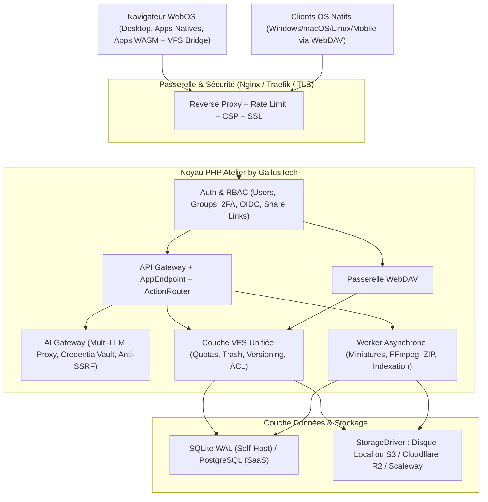

# 🗺️ Atelier by GallusTech — Feuille de Route Produit, Technique & Business (`ROADMAP.md`)

Ce document présente la **vision stratégique**, l'**écart technique** vis-à-vis des plateformes cloud établies (*Nextcloud / ownCloud, Google Drive, Dropbox, Synology DSM, Pixieset*) et le **plan de transformation progressif** permettant de faire évoluer **Atelier by GallusTech** d'une galerie/WebOS mono-admin auto-hébergée vers un **produit Cloud & Bureau Web souverain commercialisable**.

> 📌 **Articulation avec [`TODO.md`](TODO.md)** :
> - `TODO.md` suit le **backlog opérationnel court terme** (fonctionnalités applicatives WebOS, jeux, outils, qualité).
> - `ROADMAP.md` définit la **trajectoire produit, architecture cloud, hébergement et monétisation** à moyen/long terme.

---

## 1. Vision Produit & Avantage Compétitif (« Unfair Advantage »)

### ❌ Le piège à éviter
Affronter frontalement **Google Drive / Dropbox** (stockage quasi gratuit + suite collaborative temps réel + effet réseau) ou **Nextcloud / ownCloud** (groupware institutionnel lourd avec 300 plugins CalDAV/CardDAV/Collabora) est un combat asymétrique perdu d'avance pour une petite équipe.

### ✅ Notre différenciateur réel
Atelier by GallusTech dispose déjà d'un ADN unique que les clouds classiques n'ont pas :

1. **Un Bureau WebOS complet + Studio Créatif WASM côté client (`WebAppHost` + `WebAppVfsBridge`)** :
   - Au lieu d'une simple liste de fichiers, l'utilisateur dispose d'un **bureau fenêtré fluide** capable d'ouvrir, éditer et sauvegarder directement dans son VFS des médias complexes (PSD, PDF, vidéo, audio, EXIF, cartes GPS, documents Markdown/LaTeX) via des applications **WebAssembly**.
   - **Avantage économique décisif en SaaS** : tout le calcul lourd (retouche d'image, édition PDF, rendu graphique) s'exécute **sur le CPU/GPU du client**, pas sur le serveur. Le coût serveur se résume presque uniquement au stockage objet (~0,015 €/Go/mois) + un micro-conteneur PHP/Nginx.
2. **Légèreté radicale & zéro usine à gaz** :
   - Beaucoup d'indépendants, de créatifs et de PME fuient Nextcloud (lenteur, dépendances lourdes, mises à jour fragiles). Un équivalent rapide, élégant et déployable en 60 secondes façon **« Synology DSM + Creative Studio dans un onglet »** comble un vrai vide du marché.
3. **Architecture modulaire & extensible (`apps/`)** :
   - Capacité éprouvée à héberger des **modules métier privés en marque blanche** (sans toucher au noyau) — un levier B2B immédiat.

---

## 2. Positionnement Marketing : 3 Segments Cibles Prioritaires

| Positionnement | Cible principale | Promesse client | Concurrents remplacés |
|---|---|---|---|
| **1. Creative Cloud & Media Hub Souverain** *(Priorité #1)* | Photographes, graphistes, vidéastes, petites agences, créateurs indépendants | *« Vos galeries clients HD, sélections commentées, cartes EXIF et outils de retouche PSD/PDF directement dans le navigateur — sans abonnement Adobe ni WeTransfer, hébergé en Europe ou chez vous. »* | Pixieset, Frame.io, Adobe CC, WeTransfer + Drive |
| **2. Bureau WebOS Personnel / Petite Équipe** | Freelances, associations, écoles, passionnés de self-hosting et souveraineté numérique | *« Un bureau complet dans un onglet, rapide et élégant, auto-hébergeable en 1 clic sur un NAS ou un mini-VPS à 5 €/mois. »* | Nextcloud, ownCloud, Puter.com, Cozy Cloud, CasaOS |
| **3. Portail WebOS Marque Blanche (B2B)** | PME techniques, centres de formation, clubs, simulateurs, collectivités | *« Un espace bureau web à votre marque combinant gestion documentaire sécurisée et vos propres applications métier privées dans `apps/`. »* | Intranets sur mesure, SharePoint léger |

---

## 3. Analyse d'Écart (Gap Analysis) : Aujourd'hui vs Produit Cloud

| Capacité | État actuel (Atelier by GallusTech) | Cible Cloud / SaaS | Priorité |
|---|---|---|---|
| **Authentification & Utilisateurs** | Multi-utilisateurs + groupes + homes `storage/users/` + box login dédiée (`Phase A.1`) | Inscription autonome, vérif email, 2FA/TOTP, codes de secours, invitations, SSO (OIDC/LDAP) (`Phase A.2`) | **Critique** |
| **Partage externe** | Dossiers `.public` / `.private` / `.password` | Liens signés temporaires (expiration, mot de passe, quota, lecture seule vs boîte de dépôt) | **Critique** |
| **Stockage & Gros fichiers** | Disque local + upload PHP standard | Abstraction `StorageDriver` (Local + S3/R2/MinIO), uploads fragmentés (*chunked/TUS* multi-Go), quotas, corbeille 30j, versioning | **Critique** |
| **Base de données & Recherche** | `scandir()` + caches JSON plats | **SQLite WAL** (mono-instance zéro-dépendance) / **PostgreSQL** (SaaS) pour indexation instantanée, droits, métadonnées, audit | **Élevée** |
| **Accès Desktop & Mobile** | Navigateur web uniquement | Passerelle **WebDAV** (montage natif Windows/macOS/Linux/mobile) + PWA mobile + auto-upload photo | **Élevée** |
| **Jobs asynchrones** | Miniatures, ZIP, FFmpeg synchrones en PHP | File de tâches en arrière-plan (miniatures, transcodage HLS, archives lourdes, scan antivirus, purge) | **Moyenne** |
| **Déploiement & Exploitation** | Installation manuelle PHP / Apache | Image **Docker** officielle, Docker Compose 1-clic, installateur web, mises à jour automatisées, métriques/backups | **Critique** |
| **Marque Blanche & Galeries Clients** | Thèmes + titre configurables | Logo/domaine/thème par tenant, galeries de livraison clients (favoris, validation, filigrane, export HD) | **Élevée** |
| **Assistant & Agent IA WebOS** | Aucun pont IA intégré | **Agent IA universel (« Atelier Copilot »)** configurable par utilisateur (cloud ou Ollama local), accès rapide bas-gauche et pilotage unifié des apps natives, jeux et WASM (`craft-web-api` / `webos:agent-*`) | **Élevée** |

---

## 4. Architecture Cible Cloud (Vue d'Ensemble)

> **Principe fondamental préservé** : en mode auto-hébergé (*Community / Single-Node*), **SQLite (`PDO_SQLITE`) + disque local** restent le mode par défaut afin de conserver l'ADN *« zéro serveur de base de données externe, déploiement en 60 secondes »*.

---

## 5. Feuille de Route Technique par Phases

### 🟦 Phase A — Socle Multi-Utilisateurs, RBAC, Inscription Autonome & 2FA

#### ✅ Phase A.1 — Socle Multi-Utilisateurs, Volumes Montés & Liens Signés *(Livrée & Auditée)*
*Objectif : passer du modèle mono-admin à une vraie gestion d'utilisateurs et de partages professionnels tout en préservant la rétrocompatibilité des dotfiles et la galerie publique.*

- [x] **Couche Données Relationnelle dual-driver (`AtelierStore`)** : `PDO_SQLITE` WAL (`storage/atelier.sqlite`) automatique si activé + fallback JSON atomique verrouillé (`storage/atelier_db/`) avec migrations versionnées et 11 tables : `users`, `groups`, `group_members`, `user_shares`, `share_links`, `acl_rules`, `tags`, `item_tags`, `item_metadata`, `vault_keys`, `audit_logs`.
- [x] **Comptes, Groupes & Authentification (Socle)** :
  - Rôles système (`superadmin`, `admin`, `user`, `guest`), hachage `PASSWORD_ARGON2ID` (fallback `PASSWORD_BCRYPT`), revalidation de session à chaque requête (`AuthManager::revalidateActiveUser()`), rétrocompatibilité admin legacy (`.admin_password_hash`).
  - Box de connexion/compte dédiée centrée sur bureau flouté (`system/userland/services/AuthModalService.js`) avec emplacements prêts pour 2FA/TOTP et QR.
  - Panneau **Utilisateurs & Partages** intégré dans les Paramètres (`apps/settings/users-panel.js`) + Journal d'audit sécurité (`AuditLogger`).
- [x] **Espaces isolés, Partages inter-utilisateurs & Volumes Montés** :
  - Stockage utilisateur séparé dans `storage/users/<username>/` (avec `.htaccess` + `.private`), laissant `storage/media/` intact comme galerie commune/publique.
  - Permissions `read` / `write` / `admin` par utilisateur ou groupe (`ShareManager`), montage visuel en **icône de disque sur le Bureau** (`DesktopShortcuts.js`, badges `R`/`RW`/`🔐`) et dans la **barre Volumes Montés** de l'Explorateur et du sélecteur VFS (`ShareVolumesService.js`, `FilePickerService.js`).
- [x] **Liens de partage signés (`?share=<token>`)** :
  - Date d'expiration, mot de passe optionnel, limite de téléchargements, mode **Boîte de dépôt** (`drop`, upload seul) et révocation instantanée (`access_share_link`).
- [x] **Registre de Formats dynamique (`FormatRegistry`) & Pont VFS WASM** :
  - Auto-enregistrement des formats par les apps natives (`apps/*/manifest.json`) et externes/WASM (`StandaloneWebAppManifestSynthesizer` + `config/external_apps.json`) avec blacklist sécurité immuable, et compatibilité `Promise` multi-realm (`wasm-bindgen`).
- [x] **Socle futur Tagging / Classification & Cryptographie E2EE** :
  - Schéma et APIs prêts pour le tagging/classification (`tags`, `item_tags`, `item_metadata.classification`) et le chiffrement bout-en-bout côté client (`vault_keys`, `item_metadata.is_encrypted`/`crypto_algo`/`crypto_iv`, `user_shares.crypto_wrapped_key`, `users.public_key`/`key_salt`).

---

#### ✅ Phase A.2 — Inscription Autonome, Vérification Email, 2FA TOTP & Pilotage Admin *(Livrée & Testée)*
*Objectif : boucler un cycle de vie de compte 100 % autonome, sécurisé par défaut (`secure-by-default`), sans dépendance externe (PHP natif + Vanilla JS) et intégralement configurable par l'administrateur.*

##### 1. Modèle de données (Migration v2 `AtelierStore`) & Configuration Admin (`AuthSettings`)
- [x] **Migration v2** (`SqliteStoreDriver.php` + `JsonStoreDriver.php`) :
  - Extension de la table `users` : `email_verified_at` (`INTEGER NULL`), `approval_status` (`approved` | `pending` | `rejected`), `totp_confirmed_at` (`INTEGER NULL`), `totp_recovery_codes_json` (tableau de codes hashés), `totp_last_step` (compteur anti-replay TOTP).
  - Nouvelle table `auth_tokens` : `id`, `user_id`, `token_hash` (**SHA-256 uniquement — aucun token stocké en clair**), `type` (`email_verify` | `password_reset` | `invite`), `target_email`, `meta_json`, `expires_at`, `used_at`, `created_at`.
- [x] **Nouveau service `system/kernel/Auth/AuthSettings.php`** (`storage/auth_settings.json` via `ConfigStore`) :
  - **Mode d'inscription** :
    - `disabled` *(défaut sécurisé)* : création de compte réservée à l'admin.
    - `invite_only` : inscription possible uniquement via un lien/code d'invitation généré par l'admin.
    - `approval` : inscription autonome + vérification email + validation manuelle par un admin avant activation.
    - `open` : inscription autonome complète activée dès la vérification de l'email.
  - **Règles comptes & anti-abus** : vérification email obligatoire (`bool`), TTL des liens de vérification/reset (ex. 24 h / 1 h), liste blanche/noire de domaines email (`allowed_email_domains`, `blocked_email_domains`), quota disque par défaut (`default_quota_bytes`), groupes assignés automatiquement (`default_group_ids`), longueur minimale du mot de passe, honeypot invisible + `RateLimiter` par IP et par email.
  - **Politique 2FA (TOTP)** : `disabled` | `optional` | `required_admins` | `required_all`.
  - **Transport Email** : driver `outbox_log` (boîte locale `storage/mail_outbox/` pour dev/tests sans serveur SMTP), `php_mail` (`mail()`), ou `smtp` (`host`, `port`, `encryption`: `tls`/`ssl`/`none`, `username`, `password` jamais renvoyé en clair à l'UI, `from_email`, `from_name`, `public_base_url` pour des liens propres derrière reverse proxy).

##### 2. Moteur Email natif (`Mailer`) & Cycle de vie Inscription / Vérification / Récupération
- [x] **Nouveau module `system/kernel/Mail/Mailer.php`** *(100 % PHP natif, zéro dépendance Composer)* :
  - Client SMTP via `stream_socket_client()` (`EHLO`, `STARTTLS`, `AUTH PLAIN`/`LOGIN`, `MAIL FROM`/`RCPT TO`/`DATA`) + fallback `mail()` + mode `outbox_log`.
  - Templates d'emails multilingues (`fr` / `en` / `ja`) : vérification d'adresse email, lien d'invitation, notification d'approbation/refus, réinitialisation de mot de passe, email de test admin.
- [x] **Nouveau module `system/kernel/Auth/RegistrationService.php`** & endpoints API (`AuthActions.php` / `UserActions.php`) :
  - `register` : validation identifiant/email/domaine/mot de passe, honeypot + rate-limit, création du compte en état **inactif** (`is_active = 0`). **Invariant disque** : `storage/users/<username>` n'est créé qu'à l'activation effective du compte (aucune pollution disque par des inscriptions non vérifiées ou bots).
  - `verify_email` : vérifie le token SHA-256 à usage unique non expiré, marque `email_verified_at`, puis active le compte et crée son home (modes `open`/`invite_only`) ou le place en file d'approbation admin (mode `approval`).
  - `resend_verification` (rate-limité) : invalide les anciens tokens de vérification et émet un nouveau lien.
  - `request_password_reset` & `confirm_password_reset` : réponses **anti-énumération** (ne révèle jamais si un email existe), révocation des anciens tokens, hachage Argon2id du nouveau mot de passe + log d'audit.
  - Invitations & approbations admin : `create_invite`, `list_invites`, `revoke_invite`, `approve_user`, `reject_user`.

##### 3. Authentification 2FA TOTP (RFC 6238), Codes de Secours & QR Code Local
- [x] **Nouveau module `system/kernel/Auth/TotpManager.php`** *(PHP pur, zéro dépendance)* :
  - Génération de secret Base32 160 bits (`random_bytes(20)`) et URI standard `otpauth://totp/<Issuer>:<username>?secret=...&issuer=...`.
  - Vérification RFC 6238 (SHA-1, 6 chiffres, période 30 s, tolérance ±1 pas, `hash_equals`, protection **anti-replay** via `totp_last_step`).
  - Génération de **8 codes de secours à usage unique** (affichés une seule fois à l'enrôlement, stockés hashés dans `totp_recovery_codes_json`, consommables une seule fois).
- [x] **Générateur de QR Code SVG 100 % local (`QrCodeSvg.php`)** :
  - **Invariant sécurité** : le secret TOTP ne transite jamais par un service QR externe ; rendu SVG purement local côté serveur.
- [x] **Flux de connexion sécurisé en 2 temps (`AuthActions.php`)** :
  - Étape 1 (`login`) : si mot de passe valide et 2FA actif, création uniquement d'un challenge de session temporaire (TTL 5 min, **sans** authentifier `$_SESSION['sg_user']` ni `$_SESSION['is_admin']`) et retour `{ requires_2fa: true }`.
  - Étape 2 (`verify_2fa_login`) : validation du code TOTP ou d'un code de secours, puis ouverture réelle de la session avec `session_regenerate_id(true)`.
  - Enrôlement forcé (`requires_2fa_setup: true`) si la politique admin impose le 2FA (`required_admins` / `required_all`) sur un compte non encore équipé.
  - Endpoints self-service utilisateur : `begin_2fa_setup`, `confirm_2fa_setup`, `disable_2fa` (avec confirmation du mot de passe), `regenerate_recovery_codes`.

##### 4. Parcours UX complet dans `AuthModalService.js` & Routes URL (`index.php`)
- [x] **Onglet / Mode *Créer un compte*** dans [AuthModalService.js](file:///c:/Users/ec135/AndroidStudioProjects/SimpleGallery/system/userland/services/AuthModalService.js) :
  - Visible uniquement si l'inscription est autorisée (`window.SG_AUTH_POLICY`) ou lorsqu'un lien `?invite=<token>` est ouvert.
  - Champs : identifiant, nom affiché, email, mot de passe + confirmation (indicateur de robustesse), code d'invitation (si requis), honeypot invisible.
  - Écran post-inscription clair (*« Vérifiez votre boîte mail »* + bouton *« Renvoyer le lien »*).
- [x] **Prise en charge automatique des liens URL** au chargement d'[index.php](file:///c:/Users/ec135/AndroidStudioProjects/SimpleGallery/index.php) :
  - `?verify_email=<token>` → ouvre la box dédiée, valide le lien et propose la connexion (ou l'enrôlement 2FA si imposé).
  - `?reset_password=<token>` → ouvre directement le formulaire de définition du nouveau mot de passe.
  - `?invite=<token>` → ouvre la création de compte avec le jeton d'invitation pré-validé.
- [x] **Assistant 2FA & Récupération** :
  - Dans la vue *Mon Compte* de `AuthModalService` (ou forcé à la 1re connexion) : QR code SVG local + clé manuelle copiable + champ de confirmation 6 chiffres + téléchargement/copie des codes de secours + désactivation sécurisée.
  - Lien **« Mot de passe oublié ? »** intégré à l'écran de connexion.

##### 5. Panneau Admin, i18n, Qualité & Extensions Phase A.2
- [x] **Panneau Admin dans [apps/settings/users-panel.js](file:///c:/Users/ec135/AndroidStudioProjects/SimpleGallery/apps/settings/users-panel.js)** :
  - Carte **Inscriptions & Politique 2FA** (mode d'inscription, politique 2FA, domaines autorisés/bloqués, quota & groupes par défaut, longueur min mot de passe).
  - Carte **Email & SMTP** (choix driver, paramètres SMTP, URL publique, bouton **« Envoyer un email de test »**, aperçu des derniers emails en mode `outbox_log`).
  - File des **comptes en attente d'approbation** (*Approuver* / *Refuser*) et gestionnaire de **liens d'invitation** (générer, copier le lien, révoquer).
- [x] **Internationalisation stricte (`fr` / `en` / `ja`)** :
  - Clés `auth_modal.*` dans `locales/{fr,en,ja}.json` ; clés admin dans `apps/settings/locales/{fr,en,ja}.json` ; zéro chaîne de repli en dur dans `this.t()`.
- [x] **Suite de tests automatisés dédiée (`tests/SecurityUnitTest.php`, `tests/GeneralUnitTest.php`, `tests/test_js_runtime.mjs`)** :
  - Inscription autonome (refus si `disabled`, filtrage domaines, tokens expirés/réutilisés, mode `approval`, mode `invite_only`, home non créé avant activation).
  - TOTP RFC 6238 (vecteurs standards, anti-replay, codes de secours, non-élévation de session avant étape 2 du login, enrôlement obligatoire).
  - Reset mot de passe anti-énumération, `Mailer` mode `outbox_log`, parité stricte i18n FR/EN/JA, parcours UI `AuthModalService`.
- [x] **Compléments Phase A.2 livrés** :
  - URL courte de partage `/s/<token>` (réécriture Apache dans `.htaccess` + rétrocompatibilité `?share=<token>`).
  - Quotas disque visuels (Explorateur + Mon Compte) et application stricte côté serveur sur `upload_file` (HTTP 413 si dépassé).
  - Suivi et révocation à distance des sessions actives (`user_sessions` / `SessionRegistry`, révocation individuelle ou de tous les autres appareils).
  - Client SSO **OpenID Connect (OIDC)** natif sans dépendance (`OidcProvider.php`, Discovery + PKCE S256 + provisionnement JIT optionnel).
  - Refonte ergonomique du Panneau de Configuration en **navigation verticale latérale catégorisée** (`WebOSApp` `tabLayout: 'sidebar'`, sections dédiées : Sécurité & Droits, Utilisateurs & Groupes, Inscriptions/2FA/SSO, E-mail & SMTP, Partages/Liens/Audit).
  - **Isolation complète multi-utilisateurs (Bureaux & `localStorage`)** : bureau personnel dans `users.preferences_json`, bureau admin legacy isolé dans `storage/desktop_admin.json`, gestion/publication du modèle global `storage/desktop.json`, cloisonnement de `sys.storage`, préférences synchronisées et applications (`tribune`, `settings`, `browser`, `explorer`, `WebAppVfsBridge`).
  - **Matrice de droits en cascade à 3 niveaux (`PermissionsManager` + Migration v4)** : Rôle (`anonymous` / `guest` / `user`) → Surcharges Groupe (`deny` prioritaire sur `allow`) → Surcharges Utilisateur (prise d'effet en direct), tout en conservant l'étanchéité stricte des ACL `ShareManager` sur `users/` et les partages.
  - **Export RGPD (archive ZIP signée) & Suppression autonome de compte (`AccountExportService` + `export.php` + `/e/<token>`)** : génération d'archive ZIP complète à durée limitée (`6h`/`24h`/`72h`), vérification SHA-256 + transfert complet côté serveur, confirmation explicite de réception avec purge immédiate du disque, et suppression sécurisée du compte (mot de passe + 2FA + confirmation nom d'utilisateur + anti-verrouillage dernier admin).
  - **Guide d'Administration complet** ([docs/admin-guide.md](docs/admin-guide.md)).

---

### ✅ Phase B — Abstraction Stockage (`StorageDriver`), Connecteurs Cloud Externes, Gros Fichiers & Résilience *(Livrée & Testée)*
*Objectif : supporter des téraoctets sur stockage objet peu coûteux, monter des ressources cloud externes dans le VFS unifié, et manipuler des fichiers vidéo/PSD de plusieurs gigaoctets.*

- [x] **Interface `StorageDriverInterface` & Coffre Chiffré (`CredentialVault` AES-256-GCM)** :
  - `LocalFilesystemDriver` (mode natif sandboxé, zéro surcharge).
  - `S3StorageDriver` (natif PHP **AWS SigV4** zéro dépendance : AWS S3, **Cloudflare R2**, Backblaze B2, Scaleway Object Storage, MinIO) avec génération d'URLs présignées GET (`buildPresignedGetUrl()`).
  - `WebDavStorageDriver` (client WebDAV natif `PROPFIND`/`GET`/`PUT`/`MKCOL`/`DELETE`/`MOVE`, parsing XML anti-XXE `LIBXML_NONET`, garde SSRF + option LAN NAS admin).
  - `GoogleDriveStorageDriver` (client REST v3 OAuth2 avec rafraîchissement automatique `refresh_token`).
- [x] **Connecteurs Cloud & Volumes Externes montés (`ExternalMountManager`, Migration v5 `external_mounts`)** :
  - Découplage **Login SSO/OIDC** vs **Volumes Externes** avec identifiants/jetons chiffrés au repos (`CredentialVault` + clé maître `storage/.vault_master.key` en `0600`).
  - Exposition VFS transparente **`ext://<mount_id>/...`** intégrée dans `ShareManager`, `GalleryActions`, `thumb.php`, `FileActions` (`upload_file`, `create_folder`, `delete_item`, `save_text_file`) et l'onglet **Stockage & Cloud** du Control Panel.
  - *Suite optionnelle (Lot 2b / Lot 3)* : connecteurs OneDrive/Dropbox, assistant OAuth interactif Google Picker (`drive.file` / Google Photos Picker API), Instagram Business/Creator Graph API & importateur d'archives Meta/Takeout.
- [x] **Uploads fragmentés & résumables (`ChunkedUploadManager` + `SyscallClient.uploadChunked()`)** :
  - Endpoints CSRF-protégés `upload_chunk_init`, `upload_chunk`, `upload_chunk_complete` (`storage/chunks/` protégé `.htaccess`), contrôle quota & `FormatRegistry` en amont, retries par fragment, compatible VFS local et `ext://`.
- [x] **Corbeille 30 jours (`TrashAndVersioningManager`) & Versioning léger** :
  - Suppression douce automatique vers `storage/trash/<scope>/` (rétention 30 jours, restauration 1-clic `restore_trash_item`, purge manuelle/globale, gestionnaire intégré dans **Stockage & Cloud**).
  - Snapshot automatique à l'écrasement (5 dernières révisions par fichier dans `storage/versions/`, `list_file_versions` / `restore_file_version` non-destructif).
- [x] **Indexation incrémentale SQLite (`FileIndexManager`, Migration v5 `file_index`)** :
  - Index incrémental (`rebuild_file_index`, `get_file_index_stats`, `search_file_index`) sautant les fichiers inchangés (`mtime` + `size_bytes`), mis à jour en temps réel sur upload/edit/delete/restore et respectant strictement les ACL `DotfileManager::isDirAccessible()`.

---

### ✅ Phase C — Interopérabilité OS (WebDAV), Jobs Asynchrones & Packaging Prod *(Livrée & Testée)*
*Objectif : rendre le produit exploitable au quotidien depuis n'importe quel appareil et déployable industriellement.*

- [x] **Passerelle WebDAV (`/dav/`)** (`WebDavServer.php`, `system/endpoints/dav.php`, `AppPasswordManager.php`, Migration v6 `app_passwords`) :
  - Montage natif RFC 4918 (`OPTIONS`, `PROPFIND`, `GET`, `HEAD`, `PUT`, `MKCOL`, `DELETE`, `MOVE`, `COPY`) dans l'Explorateur Windows, Finder macOS, Nautilus/Dolphin Linux et clients mobiles.
  - Authentification Basic Auth **exclusivement par App Passwords dédiés** (hashés, révocables, portée `read`/`write`, compatibles 2FA, protégés anti-bruteforce), exposant `/dav/home/`, `/dav/shared/<montage>/` et `/dav/public/` avec respect strict des ACL, dotfiles, extensions interdites, corbeille/versioning et quotas disque (`507`).
- [x] **Moteur de Jobs Asynchrones (`JobQueueManager.php`, `bin/worker.php`, Migration v6 `background_jobs`)** :
  - File SQLite/JSON persistante traitée par `bin/worker.php` (`--once` pour cron ou `--daemon` pour Docker/Supervisor) ou à la demande depuis l'onglet *Système* : pré-génération de vignettes (`generate_thumbnails`), réindexation SQLite (`rebuild_file_index`), archives ZIP massives (`build_zip_archive`), aperçus vidéo FFmpeg (`video_preview`), scan antivirus optionnel ClamAV (`clamav_scan`) et sauvegardes d'instance (`instance_backup`).
- [x] **Observabilité, Sauvegardes & Conformité RGPD** :
  - Journal d'audit consultable par l'Admin (*Partages, Liens & Audit*) + Export RGPD / suppression autonome de compte (*Sécurité*).
  - **Sauvegardes d'instance automatisées (`InstanceBackupService.php`)** : instantanés ZIP protégés dans `storage/backups/` (`.htaccess` `Deny from all`) incluant base SQLite/JSON, configurations, manifeste SHA-256 et médias optionnels.
- [x] **Packaging Production 1-clic** :
  - **Docker** : [Dockerfile](Dockerfile) multi-services PHP 8.3-FPM + Nginx + Supervisor (`php-fpm`, `nginx`, `bin/worker.php --daemon`) + FFmpeg + GD/WebP/Zip/SQLite, [docker/nginx.conf](docker/nginx.conf) (parité stricte `.htaccess`), [docker/php.ini](docker/php.ini) et [docker-compose.yml](docker-compose.yml) prêt pour Traefik/Caddy.
  - **Assistant d'installation web au premier démarrage (`SetupWizard.php` + `/setup`)** : diagnostic complet PHP/extensions/stockage, création du SuperAdmin initial et **auto-verrouillage définitif (`HTTP 403`)** dès qu'un administrateur existe.
  - **PWA (Progressive Web App)** : [manifest.webmanifest](manifest.webmanifest), icône vectorielle [docs/assets/atelier-icon.svg](docs/assets/atelier-icon.svg) et Service Worker sécurisé [sw.js](sw.js) (zéro mise en cache d'API ou médias privés).

---

### 🟧 Phase D — Expérience « Creative Studio & Galeries Clients » (Différenciateur Produit)
*Objectif : créer les fonctionnalités à forte valeur perçue qui déclenchent l'achat face aux clouds génériques.*

- **Mode « Galerie de Livraison Client »** :
  - Présentation soignée sans barre WebOS complexe sur les liens partagés `/s/<token>` : choix de mise en page (Mosaïque / Polaroid / Cinéma), **filigrane dynamique** sur les aperçus (protégeant les originaux HD avant validation/paiement), système de **sélection / favoris client** (*proofing*) et commentaires horodatés, téléchargement sélectif ZIP HD.
- **Intégration poussée du Studio Créatif (`WebAppHost` + `WebAppVfsBridge`)** :
  - [x] **Lot 1 — Pont natif `?host=parent` & Synthétiseur v2** *(Livré)* : auto-détection dans `HOSTING.md` du protocole `<app>:ready/open/save/dirty/failed` (+ `&author=`, `?chrome=notitlebar`, `?blank`) pour GridCraft/DeckCraft/CADCraft/FilmCraft/PdfCraft avec sauvegarde directe VFS local & Cloud `ext://` sur `Ctrl+S` et indicateur `●` non sauvegardé ; extraction enrichie des associations (`.xls`, `.pptx`, `.doc`, `.eml`, `.mbox`, `.ics`, `.vcf`, `.fcproj`, filtrage anti-faux-positifs), découverte d'icônes locales (`.svg`/`.png`/`.ico`), santé des déploiements (filtrage dossiers 0 octet), dédoublonnage SemVer dans `PluginDiscovery` et support du conteneur git-ignoré `apps/external/`.
  - [x] **Lot 2 — Déploiement Admin d'Apps Externes, Mises à jour & Associations par défaut** *(Livré)* :
    - Déploiement **réservé aux administrateurs** (`ExternalAppManager.php` + routes CSRF-protégées) via upload d'archive `.zip` **ou URL directe** (validation anti-SSRF multi-redirections, rejet Zip-Slip/symlinks/exécutables serveur `.php`/`.phar`, contrôle intégrité `index.html`/`.wasm` en staging avant bascule dans `apps/external/<app>`).
    - **Détection automatique des mises à jour amont** (comparaison SemVer via API Releases GitHub, auto-détection du dépôt depuis `README.md` ou surcharge admin) avec **file de validation administrateur** (aucune installation silencieuse : bandeau de validation **Valider et installer** / **Ignorer** dans **Panneau de configuration → Plugins**).
    - **Préférences d'associations par défaut par utilisateur** (*« Ouvrir avec »* → étoile `☆`/`★` dans l'Explorateur + carte *Associations par défaut* dans Plugins, synchronisées dans `users.preferences_json.default_apps` et prioritaires dans `AppManager` et `MediaViewerRegistry`) + éditeur visuel admin de `config/external_apps.json` et désinstallation sécurisée.
- **Marque Blanche (*White-Label*) complète** :
  - Personnalisation par instance/organisation : nom de marque, logo, favicon, domaine personnalisé (`cloud.monstudio.fr`), palette de couleurs, page de connexion et mentions légales.

---

### 🟪 Phase E — Agent IA Universel & Automatisation WebOS (« Atelier Copilot »)
*Objectif : transformer Atelier en un véritable bureau assisté par IA, souverain et agnostique du fournisseur (cloud ou LLM local), capable d'assister l'utilisateur et de manipuler **toute application existante ou future** — native (y compris les jeux), ArtCraft WASM ou externe tierce — dans le respect strict des droits de session.*

#### 1. Point d'Entrée UX dans la Barre des Tâches (Bas-Gauche)
- **Remplacement du logo redondant « Atelier » en bas à gauche** (`apps/taskbar/`) :
  - Le menu principal *Atelier by GallusTech* étant déjà ancré en haut à gauche dans la barre de menus, l'emplacement bas-gauche de la barre des tâches est dédié à l'**accès rapide Agent IA** (raccourci clavier global `Ctrl+K` / `Alt+Space`).
  - **Accès double mode** (compact → étendu) :
    - *Entrée rapide en barre des tâches* : bouton / champ prompt compact invitant à saisir une demande en 1 clic.
    - *Popup ancrée en bas à gauche* (façon *Antigravity* : ouverte juste au-dessus de l'emplacement, redimensionnable et épinglable sans bloquer le bureau) :
      - **Champ texte multiligne extensible** (`textarea` auto-grow, `Entrée` pour envoyer, `Shift+Entrée` nouvelle ligne) + bouton **Stop / Annuler** en temps réel.
      - **Barre d'options rapides intégrée** directement dans le pied de la popup :
        - **Sélecteur de modèle / profil** (bascule instantanée entre les modèles configurés par l'utilisateur : ex. Gemini, Claude, GPT, Mistral ou Ollama local).
        - **Sélecteur de niveau d'autonomie / mode** :
          - `💬 Lecture / Conseil` : l'agent inspecte le contexte et répond sans exécuter aucune mutation.
          - `🛡️ Assisté (Recommandé)` : exécute les lectures librement et demande une validation visuelle avant toute action modifiante.
          - `⚡ Autonome (App active)` : exécute les commandes métier dans la fenêtre active sans friction, tout en conservant une confirmation obligatoire pour les actions destructrices ou d'écriture disque/VFS.
        - **Indicateur de contexte actif** : puces cliquables montrant la fenêtre focalisée, le fichier ouvert ou la sélection Explorateur (désactivables d'un clic) + attachement optionnel d'une capture d'écran (`screenshot()`).
      - **Fil d'exécution transparent** : affichage pliable des appels d'outils exécutés (*« Inspection GridCraft… »*, *« Exécution `cell.set`… »*), cartes de confirmation *Approuver / Refuser* (Human-in-the-Loop) et bouton *Nouvelle conversation*.

#### 2. Page de Configuration Dédiée dans les Paramètres (`Control Panel → IA & Agent`)
- **Volet Utilisateur** *(cloisonné par compte dans `users.preferences_json`, clés API chiffrées au repos via `CredentialVault` AES-256-GCM)* :
  - **Gestion multi-profils / fournisseurs** : OpenAI, Anthropic, Google Gemini, OpenRouter, Mistral, et tout **endpoint compatible OpenAI auto-hébergé** (**Ollama**, LM Studio, vLLM, llama.cpp).
  - **Test de connexion & découverte automatique des modèles** (`/v1/models` ou `/api/tags` Ollama) afin d'alimenter le menu rapide de la popup bas-gauche.
  - **Préférences comportementales** : modèle par défaut, niveau d'autonomie par défaut, prompt système personnel, plafond d'itérations d'outils par tour (ex. 10), activation de la vision multimodale (`screenshot`), et **matrice par application** (autoriser/interdire à l'agent de piloter individuellement chaque app native, jeu ou app externe).
  - **Historique isolé par utilisateur** dans `sys.storage` (effaçable en 1 clic, purgé sur `clearUserScope()`).
- **Volet Administrateur** *(`storage/ai_settings.json`)* :
  - Activation globale et permission RBAC `can_use_ai_agent` dans la matrice 3 niveaux (`PermissionsManager` : Rôle → Groupe → Utilisateur).
  - Politique fournisseurs : liste blanche de domaines autorisés, interrupteur explicite `allow_private_lan` (pour autoriser un serveur Ollama/vLLM sur le LAN privé sans affaiblir la protection SSRF par défaut), et mode optionnel **« Modèle par défaut de l'instance »** (clé serveur administrateur mutualisée avec plafond de requêtes par utilisateur).
  - Rate-limiting par utilisateur/IP et consultation des traces d'appels d'outils dans l'`AuditLogger`.

#### 3. Architecture Universelle d'Intégration Applicative (« WebOS Agent Bus »)
*Principe directeur : **toute application existante ou future** — native, jeu ou externe/WASM — s'intègre dans le même registre d'outils côté client (`AgentToolRegistry.js`) selon ses capacités :*

| Famille d'applications | Mécanisme d'intégration | Capacités exposées à l'agent |
|---|---|---|
| **1. Noyau OS & VFS** *(toujours actif)* | Syscalls Atelier + `WindowManager` + `AppManager` | Lister/chercher/lire/créer/déplacer des fichiers (dans les ACLs & quotas utilisateur), lancer/focaliser/organiser/fermer des fenêtres, ouvrir un fichier dans une app, déclencher une sauvegarde `?host=parent`. |
| **2. Applications Natives & Jeux** (`apps/*`, `apps/games/*`) | **Contrat standard `WebOSApp`** (`getAgentContext()`, `getAgentTools()`, `executeAgentTool(name, args)`) + déclaration optionnelle `capabilities: ["agent-tools"]` dans `manifest.json` | Chaque app native existante ou future expose ses propres commandes métier : Explorateur (filtrage, tri, sélection, batch), Visionneuse Image/EXIF (rotation, recadrage, métadonnées), Doc Viewer (recherche, édition), Graphing Calc (tracer fonctions, calculs), Maps (navigation, mesures), Tribune (lecture, brouillon), **et les Jeux (`apps/games/`)** (lecture du plateau/score/règles, mode *Coach* suggérant un coup, mode *Adversaire IA* jouant un coup, commentaire de partie). |
| **3. Apps Externes ArtCraft WASM** (`apps/external/*craft*`) | **Auto-découverte dynamique `craft-web-api`** via `iframe.contentWindow.<prefix>` dans `WebAppHost` | Accès natif au même canal de contrôle que le serveur MCP desktop : `commands()` (découverte dynamique des schémas), `docInspect()`, `uiInspect()`, `execute(command, params)`, `request(method, params)` et `screenshot()` (PNG base64). *Déjà embarqué dans le `.wasm` de 6 apps déployées (`cadcraft`, `deckcraft`, `gridcraft`, `pdfcraft`, `filmcraft`, `wordcraft`) et activé automatiquement sur les autres dès leur mise à jour amont.* |
| **4. Toute Future App Externe Tierce** (non-Craft) | **Protocole coopératif ouvert `postMessage`** (`webos:agent-register-tools`, `webos:agent-context`, `webos:agent-call`, `webos:agent-result`) strictement `same-origin` | Permet à n'importe quelle WebApp tierce (React, Vue, Rust/WASM, Godot, etc.) de déclarer ses propres outils JSON Schema et son contexte vivant à l'agent Atelier. |
| **5. Fallback Universel** (apps sans API dédiée : DOSBox, EPUB Reader…) | Cycle de vie `WebAppHost` + `WindowManager` | Même sans API interne, l'agent peut lancer l'app, y ouvrir un document du VFS, surveiller l'état non sauvegardé, basculer le focus ou fermer la fenêtre. |

#### 4. Architecture Backend & Garde-fous Sécurité (Zero-Trust Agent)
- **Relais LLM 100 % côté serveur (`system/kernel/AI/LlmGateway.php` + `AiAgentActions.php`)** :
  - Adaptateurs zéro-dépendance (PHP cURL) pour les formats **OpenAI-compatible** (OpenAI, Ollama, LM Studio, OpenRouter, Mistral), **Anthropic Messages API** et **Google Gemini API** avec support streaming **SSE** et *function/tool calling* normalisé.
  - Les clés API chiffrées par `CredentialVault` sont déchiffrées uniquement côté PHP le temps de la requête sortante et ne transitent **jamais** vers le DOM ou le `localStorage`.
  - Requêtes sortantes protégées par `UrlValidator::safeCurlFetch()` (anti-SSRF, pinning IP `CURLOPT_RESOLVE`, contrôle redirections, exception contrôlée pour `allow_private_lan` admin).
- **Invariants de sécurité non négociables** :
  - **Zéro élévation de privilèges** : l'agent s'exécute strictement avec la session active de l'utilisateur (mêmes ACL `ShareManager`/`DotfileManager`, isolation `users/` et `ext://`, quotas disque `413`).
  - **Cloisonnement des actions critiques** : les routes d'administration, gestion des comptes, clés/App Passwords, paramètres sécurité/IA et suppressions définitives sont **strictement hors-scope** (jamais exposées comme outils).
  - **Human-in-the-Loop & anti-Prompt Injection** : les données lues dans les fichiers VFS, emails ou retours `docInspect()` sont systématiquement encapsulées comme *données non fiables* ; toute action classée `destructive` ou `mutate_fs` exige une approbation manuelle explicite de l'utilisateur dans la popup (avec aperçu exact des arguments) et est journalisée dans `AuditLogger`.

#### 5. Découpage de Livraison (Lots Incrémentaux)
- [x] **Lot 1 — Socle Backend LLM, Coffre Clés & Page Settings (`IA & Agent`)** *(Livré & Testé)* : `AiSettings.php`, `LlmGateway.php` (OpenAI-compatible/Ollama, Anthropic, Gemini), `AiAgentActions.php` (CSRF + SSRF + rate-limit), page de configuration utilisateur & politique admin dans `apps/settings/ai-panel.js`, permission RBAC `can_use_ai_agent`, parité i18n FR/EN/JA et tests unitaires sécurité.
- [x] **Lot 2 — Accès Rapide Bas-Gauche (Taskbar), Popup Copilot & Outils OS/VFS** *(Livré & Testé)* : remplacement du logo redondant « Atelier » en bas à gauche de `apps/taskbar/` par le lanceur/popup Copilot (champ extensible, sélecteur modèle/niveau, contexte actif, Stop, cartes de confirmation Human-in-the-Loop) + `AgentToolRegistry.js` + `AiCopilotService.js` + outils système (`WindowManager`, `AppManager`, VFS) + aide contextuelle clés API par fournisseur.
- [ ] **Lot 3 — Pont Dynamique `craft-web-api` & Protocole Ouvert `webos:agent-*`** : auto-découverte à chaud dans `WebAppHost` des apps Craft WASM (`commands()`, `docInspect()`, `execute()`, `screenshot()`), support multimodal des captures canvas, et protocole `postMessage` origin-locked pour toute future app externe tierce.
- [ ] **Lot 4 — Contrat Universel `WebOSApp` (Apps Natives & Jeux)** : hooks standards `getAgentContext()` / `getAgentTools()` / `executeAgentTool()` dans `WebOSApp.js` + intégrations pilotes sur Explorateur, Visionneuse Image, Doc Viewer, Calculatrice/Traceur, Maps et les jeux `apps/games/` (mode coach, explication de règles et adversaire IA) + documentation développeur dans `docs/apps-guide.md`.

---

### 🟥 Phase F — Infrastructure SaaS Hébergée (« Atelier Cloud »)
*Objectif : proposer un service hébergé clé en main, rentable dès les premiers clients et sécurisé par isolation stricte.*

- **Stratégie d'hébergement pragmatique : « Silo par Client » au démarrage** :
  - Plutôt que de complexifier le code avec un multi-tenancy partagé à risque, chaque client/studio reçoit **son propre micro-conteneur isolé + sa base SQLite dédiée + son préfixe/bucket S3/R2 dédié** (orchestré via Docker / Coolify / Nomad + Traefik TLS automatique).
  - **Avantages** : isolation de sécurité maximale, zéro risque de fuite entre clients, sauvegarde/migration/résiliation triviales, montée en charge linéaire.
- **Portail Client & Facturation (Control Plane)** :
  - Inscription, choix de formule, paiement récurrent (Stripe / Paddle), provisionnement automatique en < 30 secondes, gestion du domaine personnalisé et suivi de consommation de stockage.
- **Souveraineté & Confiance** :
  - Hébergement 100 % européen (Hetzner / Scaleway / OVH + R2/Scaleway Object Storage EU), chiffrement TLS 1.3 + chiffrement au repos, et option future de **coffre-fort chiffré de bout en bout (E2EE / Zero-Knowledge côté client)** via WebCrypto API.

---

## 6. Modèles Économiques & Services Vendables

### 1. Modèle **Open-Core** *(acquisition organique + licences self-hosted)*

| Offre | Cible | Prix indicatif | Inclus |
|---|---|---|---|
| **Community (Open Source)** | Particuliers, homelabs, découverte | **Gratuit** | Auto-hébergé, jusqu'à 3–5 utilisateurs, disque local, WebOS + apps natives + pont WASM, galeries publiques/privées. |
| **Pro / Studio License** | Photographes, freelances, créatifs, petites équipes | **79–149 € / an** *(ou licence perpétuelle + 1 an MAJ)* | Utilisateurs illimités, stockage **S3/R2**, WebDAV, galeries clients avancées (filigrane, sélection favoris, boîtes de dépôt), **Marque Blanche**, support prioritaire. |
| **Enterprise / White-Label** | PME, écoles, collectivités, intégrateurs | **À partir de 490 € / an** | SSO (OIDC/LDAP), journaux d'audit avancés, SLA, accompagnement intégration d'apps métier privées. |

### 2. Modèle **SaaS Hébergé (« Atelier Cloud »)** *(revenu récurrent prévisible)*

Grâce au déport du calcul lourd en **WebAssembly côté client**, la marge brute sur le stockage est très élevée :

| Formule SaaS | Stockage & Utilisateurs | Prix indicatif | Coût infra estimé (S3/R2 + micro-conteneur) |
|---|---|---|---|
| **Solo Créatif** | 250 Go · 1 utilisateur + partages clients illimités | **7–9 € / mois** | ~1,50–2,50 € / mois |
| **Studio** | 2 To · jusqu'à 5 utilisateurs · domaine perso · marque blanche | **29–39 € / mois** | ~6–10 € / mois |
| **Agence / Équipe** | 5–10 To · jusqu'à 20 utilisateurs · SSO · sauvegardes dédiées | **79–129 € / mois** | ~20–35 € / mois |

### 3. Prestations **B2B & Développement d'Apps Privées** *(financement court terme)*
- Installation souveraine sur serveur/NAS client + formation + infogérance annuelle.
- Développement au forfait d'applications métier privées dans `apps/` (modèle déjà validé en interne), finançant le développement du cœur produit sans dépendre d'une levée de fonds.

---

## 7. Stratégie de Lancement (Go-To-Market)

1. **Démo Live Publique « Zéro Friction »** :
   - Une instance de démonstration en lecture seule (reset périodique) permettant de tester le bureau WebOS, la galerie EXIF/GPS, la calculatrice/traceur et l'ouverture d'un PSD/PDF dans le navigateur en 1 clic — meilleur outil marketing possible.
2. **Communauté Self-Hosting & Open Source** :
   - Lancement avec image Docker 1-clic sur *r/selfhosted*, *Hacker News (Show HN)*, *LinuxFr*, *Product Hunt* et blogs tech francophones/européens sous l'angle : **« Un WebOS créatif ultra-léger en PHP + WASM comme alternative simple à Nextcloud »**.
3. **Validation Terrain auprès de 5 à 10 Beta-Testeurs Payants** :
   - Recruter quelques photographes, graphistes ou petites structures avant d'investir dans le Control Plane SaaS complet : valider les usages réels (galeries clients, partage, WebDAV, retouche) et ajuster les priorités.

---

## 8. Risques Majeurs & Garde-fous

| Risque | Impact | Parade |
|---|---|---|
| **Dispersion fonctionnelle** (vouloir tout faire : jeux, émulateurs, cloud pro) | Dilue l'effort et brouille le message marketing | Séparer clairement le **noyau Produit Cloud/Studio** (`ROADMAP.md`) des **apps communautaires/loisirs optionnelles** (`apps/games/`, `FEAT-11`) désactivables via `enabled_by_default: false`. |
| **Licences des apps WASM tierces** | Risque juridique si redistribution commerciale sans accord | Vérifier les licences (MIT/Apache/GPL) de chaque app embarquée en SaaS ; privilégier le téléchargement séparé ou des accords explicites avec leurs auteurs. |
| **Abus & contenus illicites (en mode SaaS)** | Blocage hébergeur / responsabilité légale | Quotas stricts, pas de plan gratuit anonyme illimité (essai limité ou carte requise), CGU claires, mécanisme de signalement/retrait rapide, logs d'audit. |
| **Sécurité multi-utilisateurs** | Fuite de données entre comptes | Couvrir chaque brique de la Phase A par une suite dédiée dans `tests/SecurityUnitTest.php` (isolation stricte des chemins, tokens de partage signés, RBAC testé en boîte noire). |

---

## 9. Prochains Jalons Concrets Recommandés

Les **Phases A, B, C** et les **Lots 1–2 de la Phase D (Studio Créatif & Apps Externes)** étant livrés et couverts par la suite de tests (981+ tests), l'ordre de plus fort retour sur investissement pour la suite est :

1. **Phase D (fin)** : **Galeries de Livraison Client (proofing, filigrane, sélection) + Marque Blanche** *(effort `M` — différenciateur commercial immédiat)*.
2. **Phase E (Lots 1 → 4)** : **Agent IA Universel (« Atelier Copilot »)** — accès rapide bas-gauche, réglages multi-fournisseurs par utilisateur, pont `craft-web-api` et contrat universel `WebOSApp` pour apps natives et jeux *(effort `M–L` — avantage produit unique sur le marché WebOS)*.
3. **Phase F** : **Démo live publique + Control Plane SaaS (« Atelier Cloud »)** *(effort `L` — monétisation récurrente en silos isolés)*.
